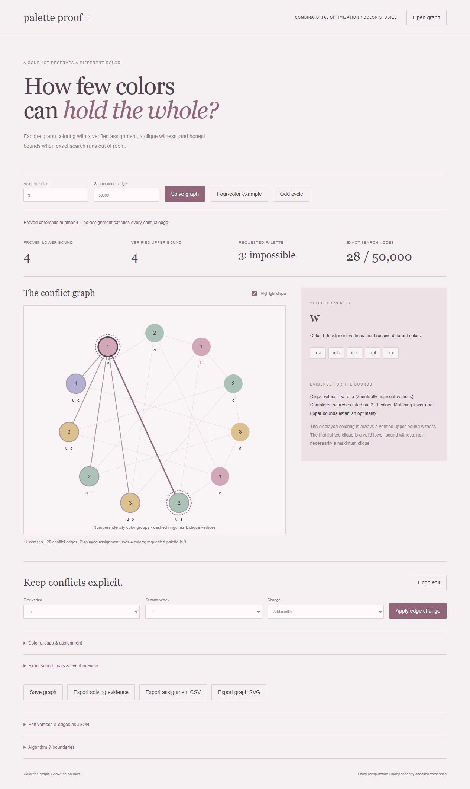

# Palette Proof

A graph-coloring workbench with verified assignments, clique witnesses, and bounded exact search. Explore conflict graphs without confusing a heuristic result or exhausted budget with a proven optimum.



## Run

Python 3.10+ serves the application. No runtime dependencies or build step.

```sh
python run.py --port 8000
```

Open http://127.0.0.1:8000. The loopback server exposes only application assets. Solving runs in a browser worker; no graph data leaves the browser.

## Features

- Interactive, keyboard-accessible graph with numbered color groups and neighbor inspection.
- Explicit lower/upper bounds and feasible, impossible, or unresolved status for the requested palette.
- Highlight a pairwise-verified clique witness.
- Add/remove conflict edges and undo up to 30 graph/settings edits.
- Inspect color groups, exact-search trials, and bounded assignment/backtrack/dead-end previews.
- Export portable graph inputs, full solving evidence, assignment CSV, and standalone graph SVG.
- Edit up to 24 named vertices and 276 undirected edges in JSON.

The [default graph](docs/example.json) is the 11-vertex Mycielski construction from a five-cycle. It has 20 edges and no triangle, yet needs four colors. The solver starts with a two-vertex clique witness, rules out two and three colors, and verifies a four-color assignment using 28 search states. An [exported graph](docs/example-graph.svg) is included.

## How bounds are established

1. A greedy saturation-first coloring provides a valid upper bound. At each step, choose the uncolored vertex with the most distinct neighbor colors, then largest degree, then earliest input position; assign the smallest available color.
2. Greedy clique construction from each starting vertex provides a valid lower bound. This witness is not claimed to be a maximum clique.
3. Exact backtracking tests unresolved color counts from the lower bound upward. It uses the same saturation-first vertex selection, fixes the clique to distinct colors, and introduces unused color labels in order to eliminate equivalent permutations.
4. A completed unsuccessful search raises the lower bound. A successful assignment lowers the upper bound. Equal bounds prove the chromatic number. Budget exhaustion retains the unresolved interval.

Every reported assignment is checked against every edge, and every clique witness is checked pairwise. A requested palette is feasible when it is at least the verified upper bound, impossible when below the proven lower bound, and unresolved otherwise. The graph always displays the upper-bound assignment, even when the requested palette is too small.

The budget counts entered partial-assignment search states across all trials, including terminal states. It ranges from 1 to 200,000. Event previews retain at most 200 events per trial; these previews are not complete proof certificates. Infeasibility is established by completed exhaustive search in this implementation. Inputs and search outcomes can be exported and rerun.

## Input

```json
{
  "vertices": ["A", "B", "C"],
  "edges": [["A", "B"], ["B", "C"], ["A", "C"]],
  "palette": 2,
  "budget": 50000
}
```

Vertices use unique ASCII identifiers of at most 20 characters, starting with a letter. Loops, duplicate undirected edges, and unknown endpoints are rejected. Palette sizes range from 1 to 24. Imported files are limited to 100 KB. Raw color arrays in evidence are zero-based; assignment records and UI color numbers are one-based.

## Verification

Node.js 22+ runs the engine tests; Python checks the static server.

```sh
npm test
npm run check
python -m unittest discover -s tests -p "test_*.py"
```

Eleven JavaScript tests include 200 random graphs compared with an independent fixed-order exhaustive oracle, the triangle-free four-color example, odd cycles, complete/edgeless graphs, disconnected components, budget-limited bounds, witness checks, deterministic replay, validation, and a case where exact search improves a greedy five-color result to four. One Python test checks HTTP assets and server boundaries. CI covers Linux and Windows.

Browser verification exercised keyboard selection, clique highlighting, budget exhaustion, requested-palette status, edge deletion/undo, trial previews, exports, and reimport. An independent Python search ruled out two and three colors for the default graph and verified its four-color assignment, absence of triangles, clique witness, 11 CSV assignments, and SVG vertices.

## Scope

This models unweighted vertex coloring on simple undirected graphs. It can illustrate conflicts in register allocation or scheduling, but does not implement register classes, preassigned colors, spills, scheduling durations, or other domain constraints. Exact search can grow exponentially. The interface gives bounded computational evidence, not a guarantee that every graph will be solved within the selected budget.

The saturation-order convention is documented in the primary [NetworkX DSATUR reference](https://networkx.org/documentation/stable/reference/algorithms/generated/networkx.algorithms.coloring.strategy_saturation_largest_first.html). Palette Proof implements its own solver and does not depend on NetworkX.
